# Mac Peripheral Control: Antigravity Master Prompt and Visual Reference Brief

Prepared for Aakash Puri. Revised 7 November 2026.

**Outcome:** a native Mac mouse and keyboard configurator with a G HUB style device workspace, automatic product image discovery, interactive physical controls, and verified input behavior. The first real device is the Kreo Chimera V2 connected through its wireless USB receiver.

## How to use this brief

1. Prefer the complete `Mac_Peripheral_Control_Reference_Pack.zip`. Extract it and open the folder in Antigravity on the Mac with the mouse attached.
2. Ask Antigravity to read this entire Markdown file and open the reference PNGs. Reading image filenames or alt text is insufficient.
3. The ZIP edition embeds local images from `references/` and works offline. The separately downloadable MD embeds the original HTTPS images and requires internet access for those images.
4. `reference_manifest.json` records each source page, original asset URL, dimensions, hash, platform evidence, and publication date where known. `Reference_Gallery.html` is a convenient offline visual index.
5. This is a build specification, not a claim that a universal driver or the requested app already exists. The visual reference files are research material; production asset rights and device behavior must be established separately.

## Prompt begins

You are the lead macOS systems engineer and product designer for this product. Build the native application in independently verifiable stages. Execute useful authorized work without asking routine implementation questions. Ask only for physical actions, credentials, account capabilities, or facts you cannot obtain yourself.

The actual connected device must be the center of the experience. Automatically identify it as far as evidence permits, retrieve the right product image, show its physical controls as an interactive model, and connect each supported control to working configuration. Deliver the visual workspace and the native input behavior together.

Read the reference atlas before writing UI code. Create a short `VISUAL_REFERENCE_READOUT.md` mapping the main screens to reference IDs and concrete implementation decisions, then continue building. Do not wait for a design approval checkpoint. Read the engineering sections as binding requirements too; an attractive UI does not establish hardware support.

## Visual reference atlas

These are retrieved real screenshots and manufacturer product images, not generated representations. The five Mac G HUB captures were published in December 2022; they establish actual Mac interaction patterns, not the appearance of a newly installed 2026 build. Current official Logitech guide images supplement them. R02 visibly uses Windows window controls, while R09 and R10 do not establish a platform. Use native Mac chrome in this product.

The primary design references are R01 for mouse assignments, R02 for the dashboard, R05 for lighting, R07 for application context, R17/R18 for complete Mac keyboard editors, and R09/R10 for keyboard layers and modifiers. Kreo assets R11 through R16 establish the first device's appearance. Product photographs, visual geometry, physical input bindings, and firmware capabilities are separate evidence.

### R01. G HUB on Mac: mouse assignments

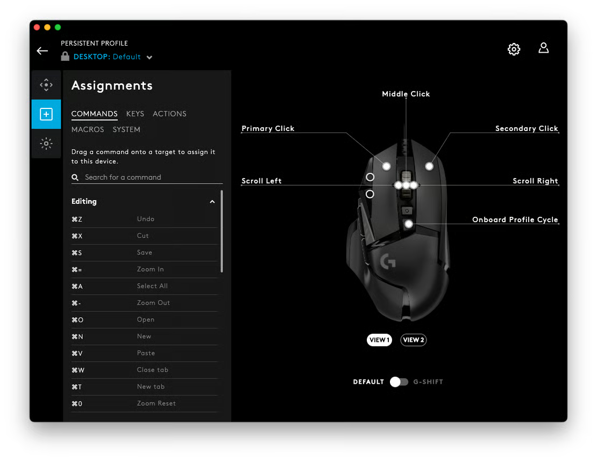

**Source:** [G HUB on Mac: mouse assignments](https://www.techrepublic.com/article/how-to-configure-logitech-g-hub-software-mac/). **Published:** 2022-12-19. **Evidence:** Verified Mac capture: traffic light window controls and Command shortcuts.

**Apply:** Primary composition reference: action library beside a large mouse, anchored callouts, view selection, and visible profile context.

### R02. Official G HUB: device dashboard

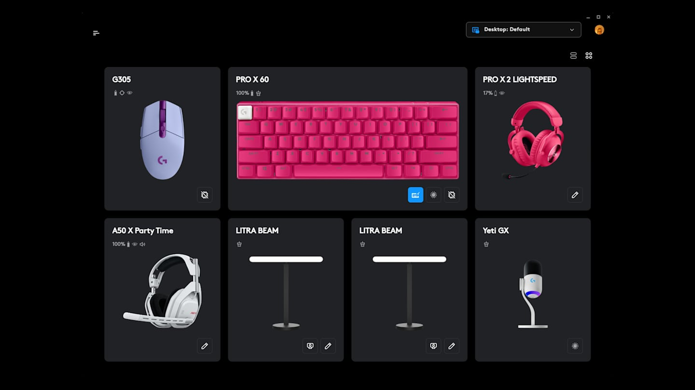

**Source:** [Official G HUB: device dashboard](https://www.logitechg.com/en-us/software/guides/g-hub-basics). **Published:** Undated; retrieved 7 November 2026. **Evidence:** Official Logitech image with Windows window controls. Use its shared visual layout, not its window chrome.

**Apply:** Reference for charcoal device cards, large real product images, restrained status, and the active profile selector. This is the underlying dashboard image used in the user supplied webpage screenshot.

### R03. G HUB on Mac: discovered device card

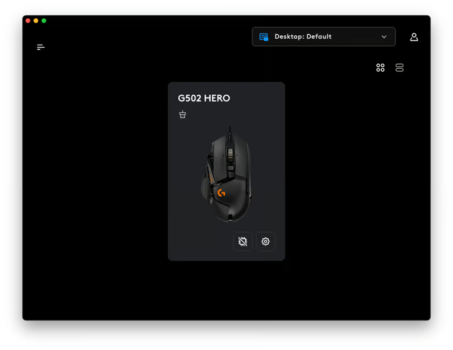

**Source:** [G HUB on Mac: discovered device card](https://www.techrepublic.com/article/how-to-configure-logitech-g-hub-software-mac/). **Published:** 2022-12-19. **Evidence:** Verified Mac capture: traffic light window controls and source explicitly about macOS.

**Apply:** A single detected mouse is sufficient content. Preserve genuine connection state and a useful product card without invented devices.

### R04. G HUB on Mac: sensitivity and report rate

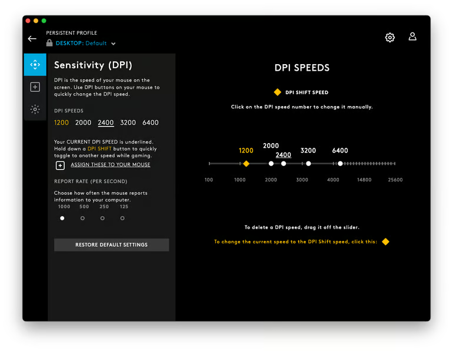

**Source:** [G HUB on Mac: sensitivity and report rate](https://www.techrepublic.com/article/how-to-configure-logitech-g-hub-software-mac/). **Published:** 2022-12-19. **Evidence:** Verified Mac capture: traffic light window controls.

**Apply:** Use the clear numeric stages and feature navigation. Device ranges and report rates must come from the actual adapter.

### R05. G HUB on Mac: LIGHTSYNC editor

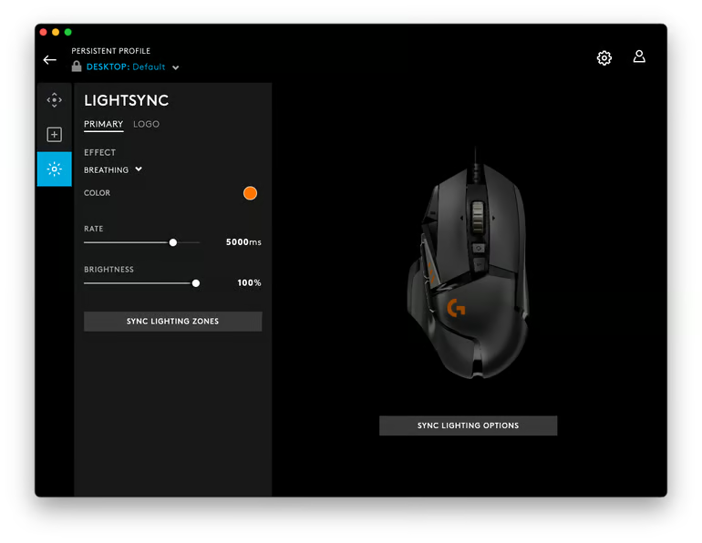

**Source:** [G HUB on Mac: LIGHTSYNC editor](https://www.techrepublic.com/article/how-to-configure-logitech-g-hub-software-mac/). **Published:** 2022-12-19. **Evidence:** Verified Mac capture: traffic light window controls.

**Apply:** Reference for effect, color, brightness, rate, and a device preview. Preview and successful hardware application must remain distinct.

### R06. G HUB on Mac: device settings

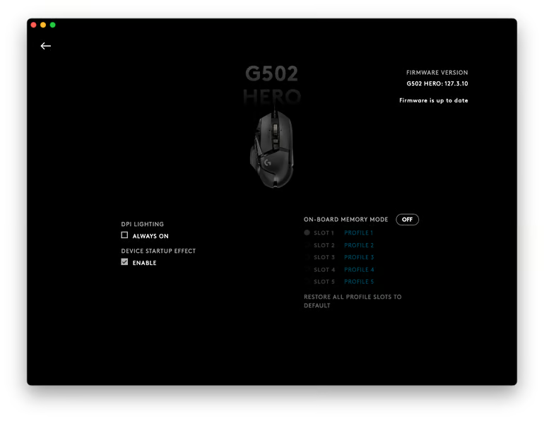

**Source:** [G HUB on Mac: device settings](https://www.techrepublic.com/article/how-to-configure-logitech-g-hub-software-mac/). **Published:** 2022-12-19. **Evidence:** Verified Mac capture: traffic light window controls.

**Apply:** Reference for separating device identity, firmware information, and onboard profiles from everyday assignments.

### R07. Options+ on Mac: device callouts and application selection

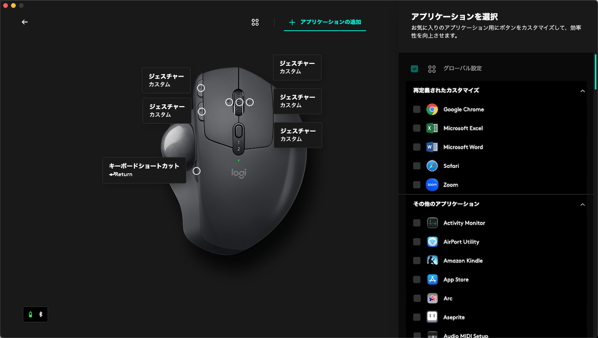

**Source:** [Options+ on Mac: device callouts and application selection](https://www.lifehacker.jp/article/2402-logicool-mouse/?page=2). **Published:** 2024-02-16. **Evidence:** Verified Mac capture: traffic light controls and Mac applications including Safari and AirPort Utility. Japanese interface.

**Apply:** Use the large physical product, readable control labels, and application scope picker. Preserve native Mac application identity in the new implementation.

### R08. Options+ on Mac: physical mouse controls

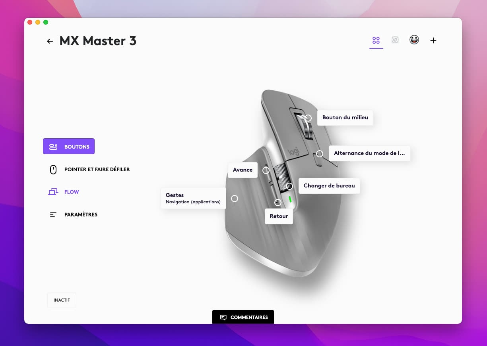

**Source:** [Options+ on Mac: physical mouse controls](https://www.macg.co/logiciels/2022/02/logi-options-est-peut-etre-une-app-inutilement-gourmande-mais-elle-est-optimisee-apple-silicon-127333). **Published:** 2022-02-21. **Evidence:** Verified Mac capture: traffic light controls, Mac desktop, and source describing the author's Mac. French interface.

**Apply:** Use this for callout placement and physical control clarity. It is an older light appearance reference, not the target color theme.

### R09. Official KEYCONTROL: keyboard selection and layers

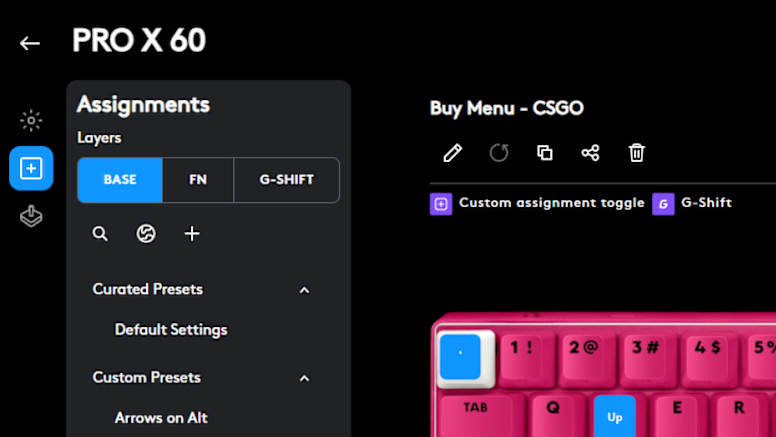

**Source:** [Official KEYCONTROL: keyboard selection and layers](https://www.logitechg.com/en-us/software/guides/keycontrol). **Published:** Undated; retrieved 7 November 2026. **Evidence:** Official Logitech interface crop. Capture operating system and build are not established.

**Apply:** Reference for a selected physical key, mapping labels, and layer selection. The supplied crop is not evidence of a full Mac keyboard screen.

### R10. Official KEYCONTROL: modifier assignment editor

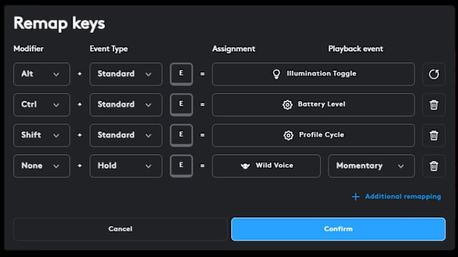

**Source:** [Official KEYCONTROL: modifier assignment editor](https://www.logitechg.com/en-us/software/guides/keycontrol). **Published:** Undated; retrieved 7 November 2026. **Evidence:** Official Logitech interface crop. Capture operating system and build are not established.

**Apply:** Reference for editing a key, modifier, event type, action, and playback behavior. Use Mac modifier names and only implemented behaviors.

### R11. Kreo Chimera V2: black top view

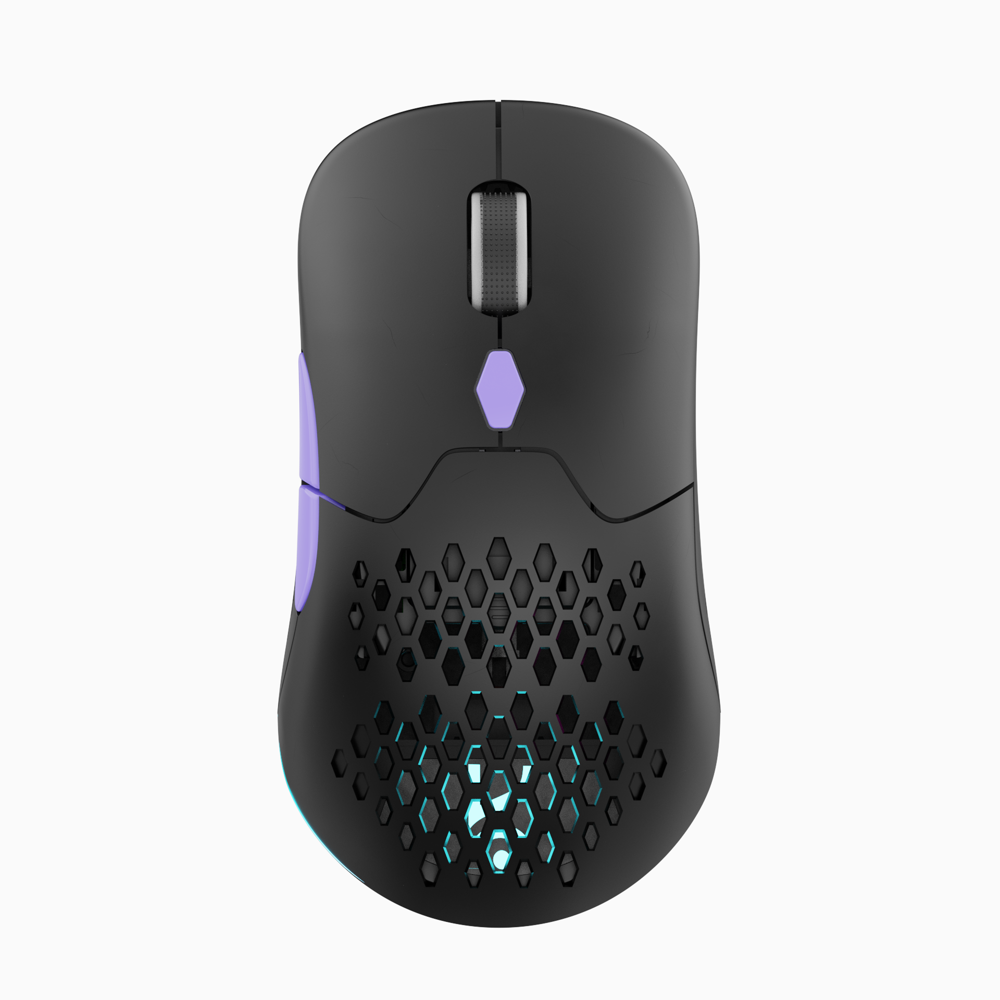

**Source:** [Kreo Chimera V2: black top view](https://kreo-tech.com/products/chimera-wireless-gaming-mouse). **Published:** Undated; retrieved 7 November 2026. **Evidence:** Official product image from the current Chimera V2 page; honeycomb upper shell.

**Apply:** Starting asset for the top view. Confirm the actual color and removable shell. The picture does not establish HID button IDs.

### R12. Kreo Chimera V2: black left side view

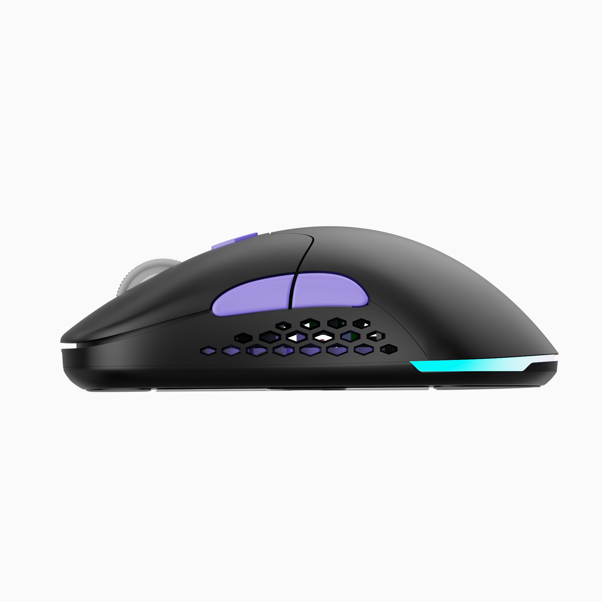

**Source:** [Kreo Chimera V2: black left side view](https://kreo-tech.com/products/chimera-wireless-gaming-mouse). **Published:** Undated; retrieved 7 November 2026. **Evidence:** Official product image from the current Chimera V2 page; both thumb buttons are visible.

**Apply:** Primary side button editor reference. The front of the mouse points left in this image. Maintain front and rear physical identities when changing views.

### R13. Kreo Chimera V2: black angled view

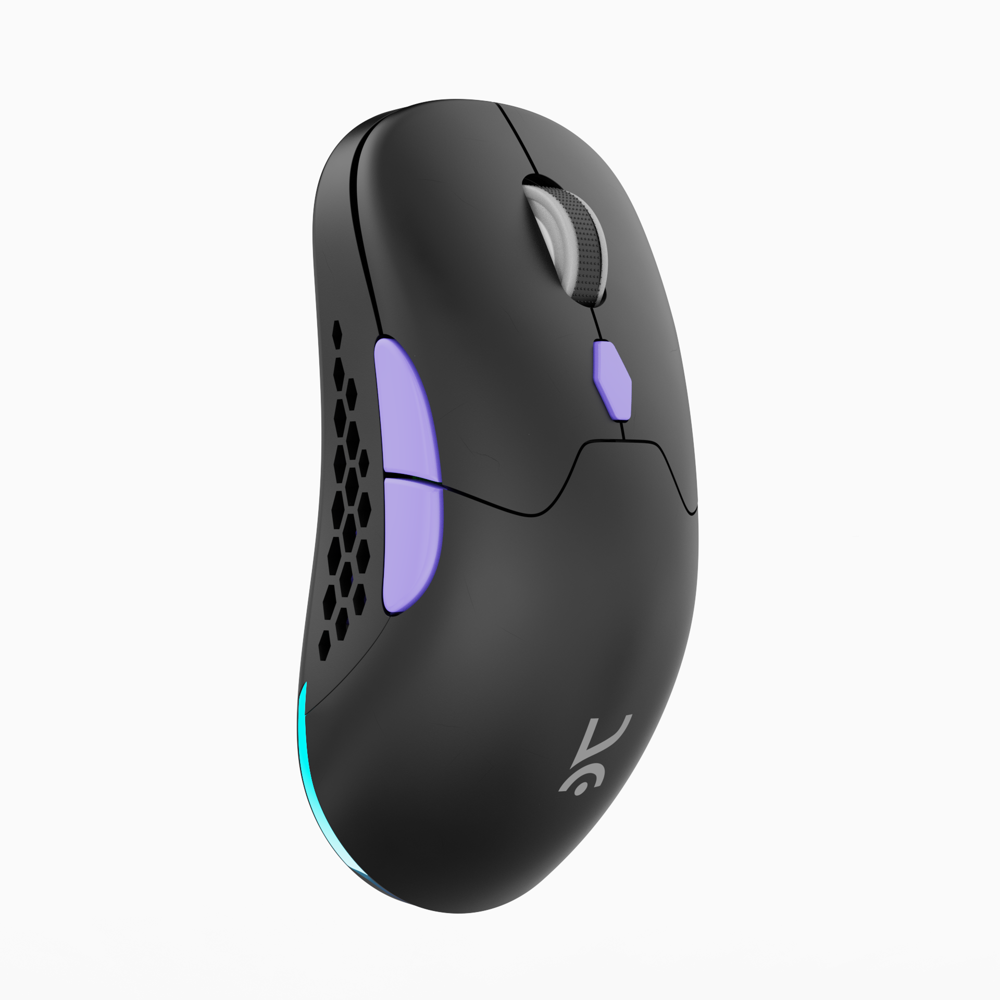

**Source:** [Kreo Chimera V2: black angled view](https://kreo-tech.com/products/chimera-wireless-gaming-mouse). **Published:** Undated; retrieved 7 November 2026. **Evidence:** Official product image from the current Chimera V2 page; solid upper shell.

**Apply:** Optional overview with both side buttons visible. Match the removable shell before claiming an exact cosmetic representation.

### R14. Kreo Chimera V2: white top view

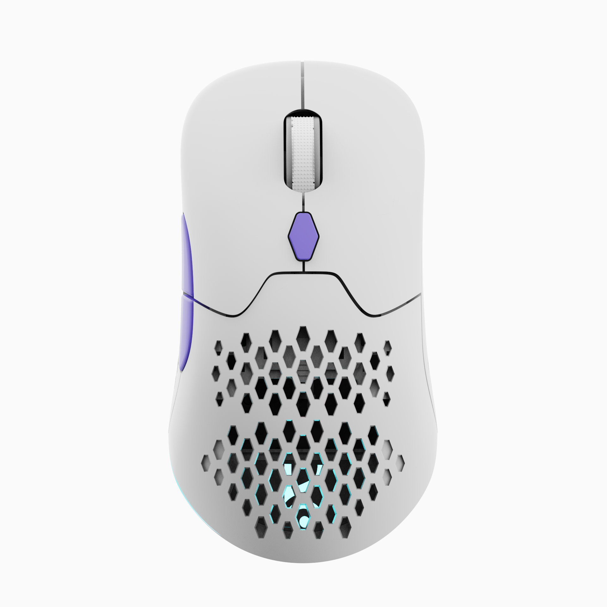

**Source:** [Kreo Chimera V2: white top view](https://kreo-tech.com/products/chimera-white-wireless-gaming-mouse). **Published:** Undated; retrieved 7 November 2026. **Evidence:** Official product image from the current white Chimera V2 page; honeycomb upper shell.

**Apply:** White variant reference. Color is unknown for the user's physical mouse until established; do not silently claim to have detected it.

### R15. Kreo Chimera V2: white left side view

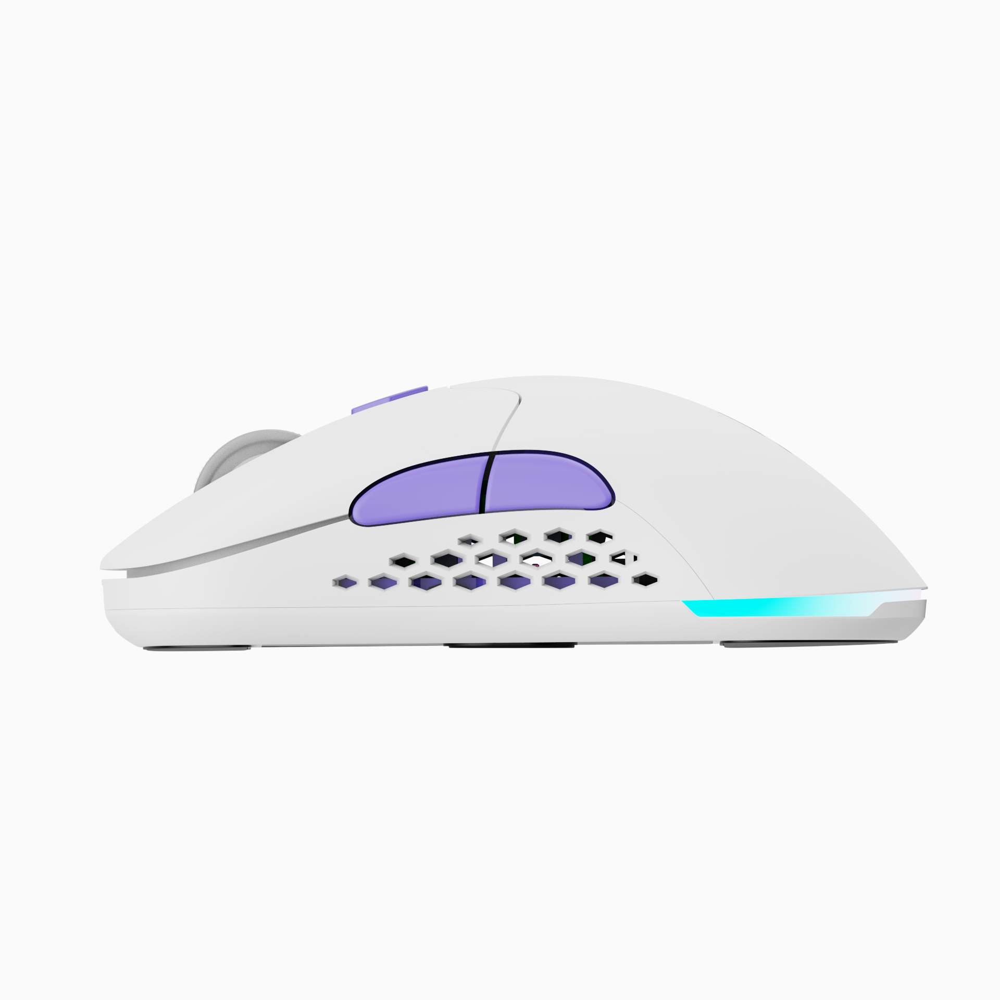

**Source:** [Kreo Chimera V2: white left side view](https://kreo-tech.com/products/chimera-white-wireless-gaming-mouse). **Published:** Undated; retrieved 7 November 2026. **Evidence:** Official product image from the current white Chimera V2 page; both thumb buttons are visible.

**Apply:** White side view for the same visual workflow. Retain its own image transform and validated hotspots.

### R16. Kreo Chimera V2: white angled view

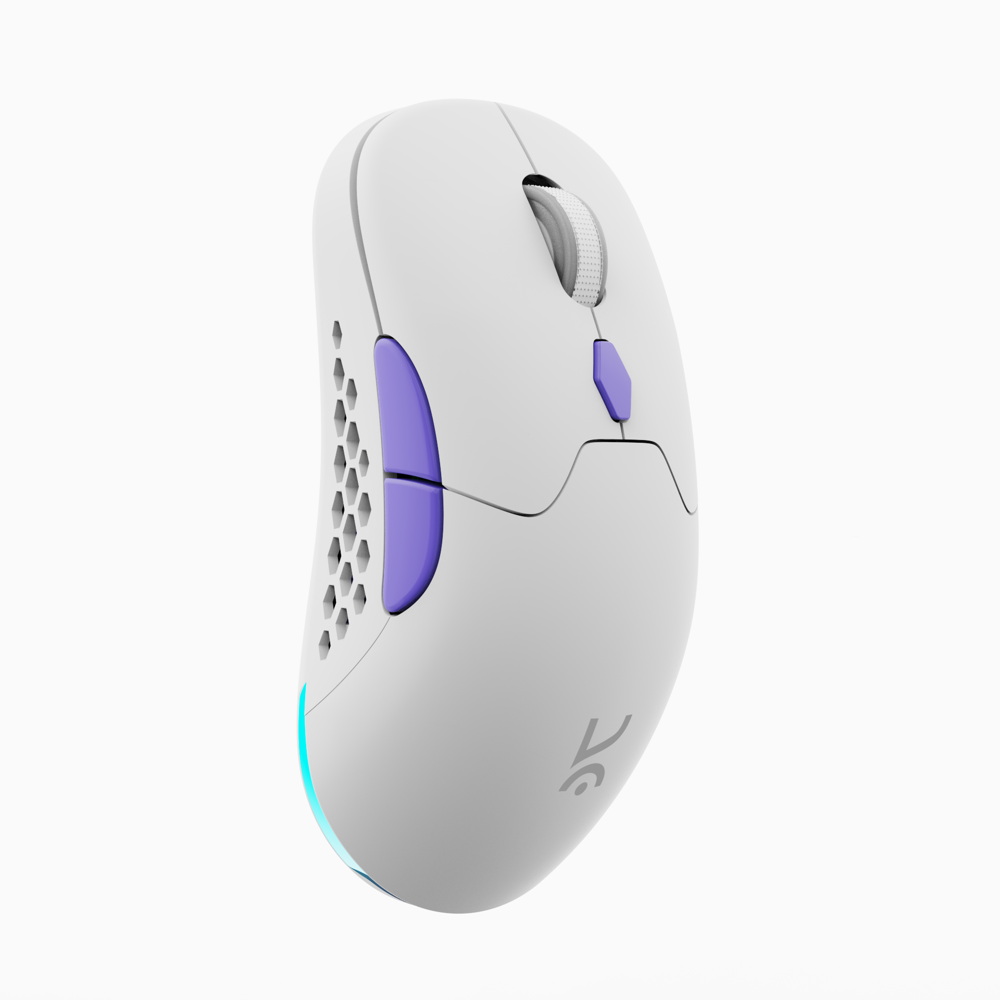

**Source:** [Kreo Chimera V2: white angled view](https://kreo-tech.com/products/chimera-white-wireless-gaming-mouse). **Published:** Undated; retrieved 7 November 2026. **Evidence:** Official product image from the current white Chimera V2 page; solid upper shell.

**Apply:** Optional white overview. These original product images have opaque near white backgrounds and require deliberate preparation for a dark stage.

### R17. Options+ on Mac: Wave Keys visual editor

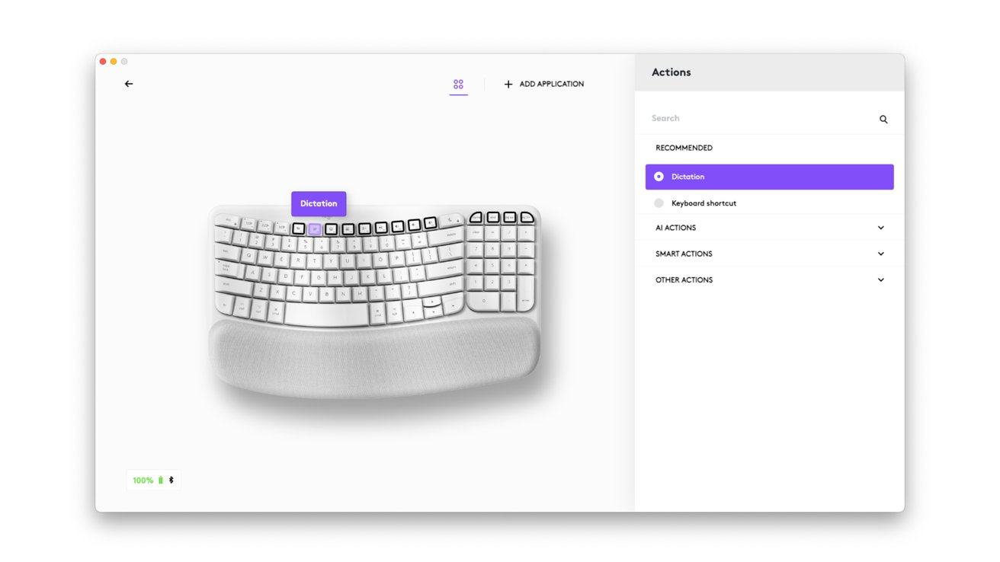

**Source:** [Options+ on Mac: Wave Keys visual editor](https://appleinsider.com/articles/24/12/29/logitech-wave-keys-for-mac-review-ergonomic-without-hurting-your-wallet). **Published:** 2024-12-29. **Evidence:** Verified Mac capture: traffic light window controls; the original review explicitly identifies Logi Options+ for macOS.

**Apply:** Full keyboard reference with a selected physical key and an action panel. Preserve the actual keyboard shape, spacing, and layout rather than drawing every keyboard as a generic rectangle.

### R18. Options+ on Mac: K380 key assignment

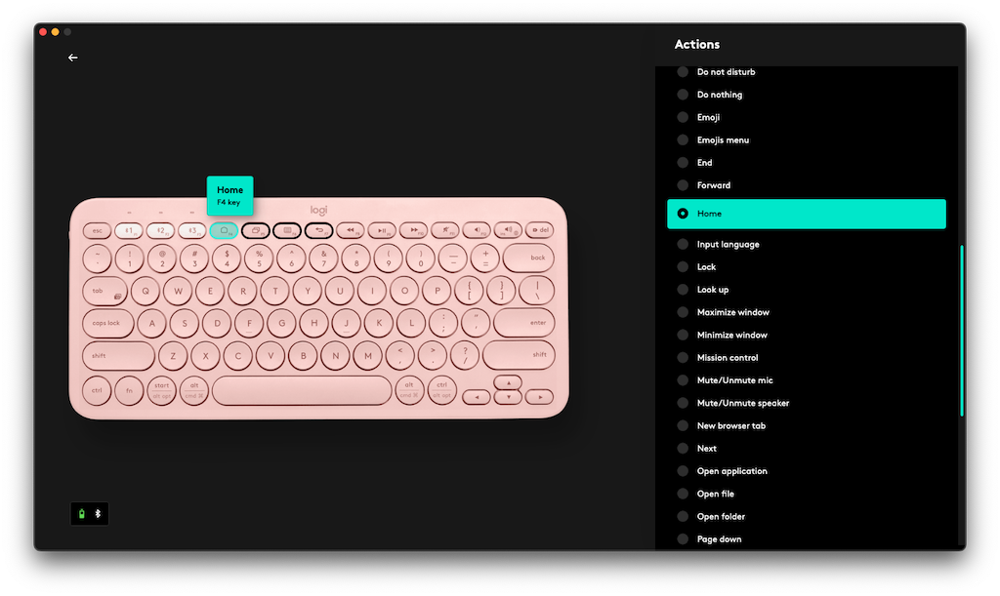

**Source:** [Options+ on Mac: K380 key assignment](https://danielphil.github.io/keyboards/k380-update/). **Published:** 2025-03-03. **Evidence:** Verified Mac capture: traffic light controls; the original author describes this macOS configuration.

**Apply:** Recent dark keyboard editor reference. F4 is selected, its current Home action is labeled on the key, and the action list reflects that choice. Use this selected key to action relationship.

## Engineering and implementation requirements

### 1. Product goal and immediate outcome

Create a single Mac control centre for mice and keyboards from multiple manufacturers, starting with my Kreo Chimera V2 wireless mouse. It is connected through its USB wireless receiver. I want its two side buttons to perform actions I choose, globally and in individual applications. The Kreo web configurator currently fails to detect or initialize my device, and my attempted USB C connection has not worked as expected.

The first demonstrable outcome is a real app that discovers the receiver, automatically resolves its product image, presents the Kreo visual editor, observes both side buttons, lets me assign and test shortcuts through its physical callouts, and retains the assignments after relaunch and reconnect. Preserve normal pointing, clicking, typing, and trackpad behaviour. Do not assume the two buttons have particular numeric IDs before observing them.

The broader product should support button and key assignments, application profiles, pointer and scroll preferences, macros, and, where verified device protocols permit, actual DPI, polling rate, lighting, battery information, and onboard profiles. Build an extensible compatibility system. Never promise every setting on every device.

### 2. Grounding and important distinctions

Research checked on 7 November 2026 establishes the following starting points. Recheck the sources when implementing because support and APIs can change.

1. Kreo's current downloads page lists a Windows installer, online software, and a manual for Chimera V2. Kreo's Kontrol page lists Chimera V2 as supported and specifies Chromium browsers such as Chrome, Edge, and Brave. Its current product page advertises web configuration on macOS, Windows, and Linux. Therefore, do not start with the assumption that there is no Mac configuration route. [1][2][3]
2. Kreo advertises Bluetooth, 2.4 GHz wireless, and wired connectivity. A receiver is a USB device from the Mac's perspective, while its downstream mouse connection is wireless. Whether configuration commands can travel through that receiver must be verified. No verified official restriction establishing Kontrol's supported connection modes was found in this research. A cable supplying power does not prove a USB data connection. [3]
3. Kreo's product FAQ names a PixArt PMW3315 sensor and a Compx CX52850P MCU. Treat these as manufacturer claims about the model, not as measurements of my physical unit or proof of its command protocol. The same page has conflicting DPI values, so do not derive an allowed hardware write range from marketing text alone. [3]
4. Kreo states that Kontrol uses WebHID. Browser WebHID does not expose protected generic keyboard and mouse collections. A compatible device can expose a separate vendor collection for configuration. A website can configure supported onboard features but cannot provide the general system input remapping service required here by itself. [4][23]
5. macOS exposes HID discovery and communication APIs and separate mechanisms for intercepting and generating session input. Discovering a device, identifying the source of an individual event, suppressing that event, and programming its firmware are different capabilities. [5][6][7]

The installed app must distinguish these two operation types throughout its UI and data model:

* **Mac behaviour:** actions performed by the running local service, including shortcuts and application profiles.
* **Device settings:** verified writes to device firmware, which may persist without this app only when the device supports that behaviour and it has been tested.

There is no universal vendor software “mainframe” to connect to. Hardware configuration requires the appropriate report protocol for the exact device, interface, firmware, and connection mode. A sensor or MCU name alone does not establish that protocol.

### 3. First task: inspect the environment and device

Before building the main interface:

1. Inspect the existing project and its instructions if a repository exists. Preserve unrelated work. If there is no project, create a clearly named project directory after verifying the development environment.
2. Record the actual macOS version, CPU architecture, Xcode and Swift versions, available SDKs, and signing capabilities. Do not interpret a browser user agent as the OS version. If running on Linux or Windows without a Mac execution target, say exactly which Mac validation steps are blocked; do not report a native app as tested.
3. Use read only discovery, including `hidutil list` and suitable IOKit or CoreHID APIs, to enumerate relevant input and vendor interfaces. Record vendor and product IDs, usage pages and usages, report descriptors where available, transport reported by macOS, registry relationships, and readable product or version information. Redact unique identifiers from shareable exports by default.
4. Group related interfaces carefully. One receiver or physical peripheral may expose several HID services. VID and PID identify a device type, not a unique physical unit. Registry IDs can change after reconnection. Identical devices and receivers serving several peripherals require explicit identity handling. Never merge them solely because their names match.
5. Provide a temporary live button inspector. Ask me to press each side button in turn. Capture only the relevant test events in memory; do not persist ordinary keyboard input. Record which events actually reach macOS, which interface produces them, and whether existing assignments produce keyboard reports instead of mouse button reports.
6. Diagnose Kontrol with the current official documentation. Separate OS discovery failure, browser permission or filtering failure, and a device selected successfully but initialization failing. If inspecting public configurator assets is useful, record relevant findings and licenses; do not copy proprietary application code into this product.
7. Compare connection modes only with my physical cooperation: receiver first, then a known data cable with the receiver removed and this mouse's Bluetooth connection disconnected, then Bluetooth if useful. Do not disconnect my keyboard or change all Bluetooth settings. Follow the exact model's documented mode instructions. Do not reset, reflash, or re pair a working receiver as a generic troubleshooting step.
8. Produce a concise evidence note with observed facts, manufacturer claims, hypotheses, and remaining blockers. Keep the baseline remapping work independent of unresolved RGB protocol work.

### 4. Architecture

Use Swift and SwiftUI, with AppKit where needed. The recommended deployment baseline is macOS 14 or later, subject to checking my actual Mac and the APIs required. Make this an explicit decision rather than silently excluding my computer. Plan Apple silicon and Intel support only where the chosen SDK and target OS support them; report which combinations have actually been built and tested.

Separate these responsibilities:

1. **Desktop UI:** device dashboard, assignments, profiles, hardware settings, permission onboarding, and diagnostics.
2. **Device discovery:** IOKit and IOHIDManager/IOHIDDevice for the compatibility baseline. Evaluate Apple's current CoreHID APIs behind an abstraction on systems that support them. Verify availability in the installed SDK. Do not require a newer framework for every user merely because a sample uses it.
3. **Input service:** a user session service using documented input APIs for the verified baseline. Use an appropriate active CGEvent tap to transform events and dispatch actions. A passive event tap cannot suppress an event. Raw HID observation alone also does not suppress original events. Prove capture, suppression, and output separately. [26]
4. **Profile engine:** deterministic action resolution using device identity when reliable and application bundle identifiers. Resolution order should be explicit, such as device plus application, device default, then global default. Distinguish an absent assignment, pass through, and intentionally disabled input.
5. **Capability and identity registry:** structured device metadata, source evidence, per transport feature support, visual definitions, and compatibility tests. Add separate image discovery, asset cache, and hotspot geometry services. They must not determine hardware write permissions.
6. **Protocol adapters:** reviewed device or protocol family modules that translate validated semantic settings into known reports. Keep transport, report encoding, settings validation, and UI separate.
7. **Lifecycle and storage:** a per user background service, authenticated local communication if separate processes are used, local profile persistence with migrations, opt in launch at login using supported ServiceManagement APIs, clear pause and quit behaviour, and clean removal.

Start with a native Mac application and local input service. A small optional search broker may hold the image search provider credential; it is not a dependency for already configured devices or ordinary input. Do not start with an Electron shell, account system, or mandatory AI calls. A future website may provide downloads, compatibility lookup, profile sharing, or configuration of a supported device through WebHID. A web UI connected to a native helper is an alternative architecture, not a way to eliminate the native input service.

Keep the event callback bounded and fast. Do not perform network requests, disk writes, blocking protocol calls, or UI work in it. Implement ordered event handling, a synthetic event marker to avoid loops, matched press and release events, cleanup of held modifiers, cancellation of running macros, and recovery from disabled event taps. Track physical and synthetic modifier state separately so cleanup releases only state owned by this app and preserves keys the user is physically holding. Latch the resolved action on button press and use that action for its corresponding release even if the foreground application or profile changes in between.

### 5. Device attribution and keyboard scope

Do not assume CGEvent contains a dependable public physical device identifier. Do not label mappings as specific to one mouse merely by associating an event with the most recently active device. Correlating raw HID observations and the merged event stream is not proof of correct isolation under simultaneous input.

The first mouse milestone may expose an explicitly labelled global extra button mapping when robust device isolation is not yet available. It must never silently substitute global behaviour for a rule labelled as specific to one device. Ambiguous device rules should pass input through and explain the limitation.

Test with a second mouse, the built in trackpad, and a keyboard. A profile selected for one device must not affect another unless the user deliberately selected a global scope.

Include keyboards in discovery and the product model from the start. Deliver a clearly scoped basic key remapping path after the mouse milestone. For simple mappings, evaluate documented macOS facilities such as HID user key mappings where appropriate, with backups, ownership, and restoration of existing settings. Verify persistence, actual device scope, and effects on other logged in users. Apple's archived technical note describes service level mappings with a scope extending across users, so do not assume per user profile storage confines the effect of such mappings. Do not overwrite another utility's mappings blindly. [18]

For advanced keyboard layers, key combinations, independent physical keyboard remaps, and low level interception, write an explicit design decision after the spike. Evaluate CoreHID virtual devices and their current entitlements on supported systems before deciding whether a HIDDriverKit extension is necessary. A virtual device supplies an output path; it does not itself identify the source of incoming input or suppress the original physical event. Treat Apple provisioning and distribution entitlements as a real gate. Do not claim that copying an entitlement string is sufficient. Do not require a kernel extension, disabling SIP, or running the entire app as root. If an entitled component is required later, isolate it and keep the baseline useful without it. [8][9]

Keys handled entirely inside hardware, including some Fn or DPI buttons, may not emit host events. Detect that limitation honestly. Respect Secure Input, protected login contexts, and applications that do not accept synthetic input. Do not claim universal behaviour in those contexts.

### 6. Capability system and hardware adapter contract

Represent a feature with more than a Boolean. Each feature needs:

* Identity and connection requirements.
* State: verified available, documented but untested, unavailable in this connection mode, blocked by permission, unsupported hardware, unknown, or failed.
* Scope: Mac behaviour, volatile device state, or persistent device state.
* Read, write, and verification abilities separately.
* Valid values, units, step sizes, and supported effects where established.
* Evidence source, observed firmware if readable, last successful test, and adapter version.
* An actionable explanation when unavailable.

For hardware settings, record desired, sent, acknowledged, read back, and physically verified states where applicable. A successful API call alone is not proof that the mouse applied a setting. If the protocol cannot read a value back, say so and use an explicitly described alternative verification rather than inventing a value.

Never label macOS pointer scaling as sensor DPI. Distinguish advertised polling rate, configured device polling rate, and a host measurement with its measurement limits. Never manufacture battery percentages, lighting zones, model renders, chipset identities, or firmware versions.

Select an adapter using verified identity and protocol evidence. Use VID/PID together with interface usages, descriptor evidence, firmware constraints, receiver channels, and documented matching rules as appropriate. A descriptor fingerprint can assist recognition but is not a universal unique identifier. The same chipset across two products does not make their command sets interchangeable.

Start with a generic input adapter and a Kreo Chimera V2 investigation adapter. Until the Kreo protocol is proven, its hardware controls must be disabled with an honest explanation while generic input remains available.

Before enabling a write:

1. Establish the exact supported interface, report type and ID, payload layout, valid range, any checksum or sequencing rules, and the device revisions and transports tested.
2. Prefer an official protocol or SDK, then compatible licensed implementations, then controlled observations of an official configurator on authorized hardware.
3. Read current values where the protocol supports it and preserve a recoverable snapshot. Describe limitations where a setting cannot be read or restored.
4. Apply only allowlisted settings through a serialized command queue with timeouts and bounded retries. Debounce sliders and avoid excessive nonvolatile writes.
5. Verify response semantics and the resulting state. An acknowledgement is not necessarily a readback.
6. On a mismatch or disconnect, stop further writes, preserve input availability, and show an actionable error.

No guessed reports, brute force command probing, arbitrary report ID sweeps, automatic firmware flashing, or automatic factory reset. The first release configures supported devices; firmware update tooling is a separate project.

### 7A. Visual contract and screen composition

The visual editor is a first release requirement. Use the reference atlas at the beginning of this brief as implementation evidence. Open the images themselves before designing. The defining experience is a large image of the connected peripheral with controls that the user can select, identify by physically pressing, and configure in place.

Use the G HUB device grid and assignment composition as the primary direction. Use the Options+ references for clear physical callouts and application selection. Build an original product with native Mac window controls, menus, focus behavior, and Command key conventions. Logitech names, logos, screenshots, and proprietary artwork remain research references. The shipped app has its own identity and appropriately licensed peripheral assets.

#### Layout and tokens

These are proposed product values, not measurements claimed to have been extracted from Logitech's software. Implement them as centralized theme and layout tokens.

| Element | Specification |
| --- | --- |
| Reference window | 1440 × 900 logical points; minimum 1100 × 720 |
| Canvas | `#0B0D10`; no large decorative gradients |
| Context panels and cards | `#1B1E24`; elevated controls `#252A33` |
| Text | Primary `#F4F6F8`; secondary `#ADB5C2` |
| Accent | `#27C7F7`; selected controls use a clear outline plus a label |
| Dividers | `#343B47`; use sparingly to separate functional regions |
| Type | SF Pro; 28 point device title, 18 point section title, 14 point body, 12 point metadata |
| Spacing | 8, 16, 24, and 32 points; 10 point card radius; 8 point control radius |
| Toolbar | 64 points; back or device switcher, device name, connection state, profile selector, pause |
| Feature rail | 64 points; Assignments, Pointer, Lighting, Settings; tooltips and accessible names |
| Context panel | 304 points on the left; switches between action library, selected control editor, or feature settings |
| Device stage | Remaining width, at least 32 point inner padding when space permits; large central product image |
| Product scale | Mouse silhouette usually 480 to 560 points high; keyboard up to 88 percent of stage width; preserve aspect ratio |
| Motion | Short 120 to 180 ms state transitions; respect Reduce Motion; no continuous decorative animation |

Keep the action library and selected control editor in the same context panel. Avoid adding a permanent third inspector that squeezes the product into a thumbnail. Profile selection may open a popover or sheet. At the minimum size, reduce whitespace and collapse secondary metadata before shrinking the product below an identifiable size. Long names and translated strings must wrap or truncate with accessible full text.

The supplied Kreo PNGs have an opaque near white background. A PNG extension does not establish transparency. Preserve these originals as evidence and prepare a faithful local cutout for the dark stage, checking the wheel, thumb buttons, shell gaps, and RGB strip. If masking is unreliable, use a deliberate neutral image surface while retaining correct geometry. Do not silently remove physical features to improve a silhouette.

Use actual device imagery at suitable resolution. A mouse silhouette should remain sharp on a Retina display. Account for padding inside the source image when sizing the visible product; fitting a square image full of empty space is insufficient. Keep every label inside the stage, and route leaders around the product without crossing adjacent labels. Do not put text over a wheel or side button.

#### Screen 1: connected devices

Follow R02 and R03. Show only devices discovered by the native service. Each card contains a large exact product image, model name or honest unresolved name, connection status, active profile, and a compact support summary. Battery appears only when readable. A keyboard may occupy a wider card than a mouse. Use generous spacing and a consistent image baseline; do not stretch the product to fill its card.

One connected mouse produces one good card. Do not add demo headsets, invented keyboards, statistics, marketing tiles, or blank placeholder cards to make the screen look populated. The empty state explains how discovery works and shows permission status only when relevant. Selecting a card opens the device workspace, preserving the selected profile.

While image discovery runs, retain the real detected name and show a restrained visual loading state. Replace it automatically with the verified image. A cached image should be displayed immediately. A device that disconnects becomes clearly inactive and stops accepting new configuration actions.

#### Screen 2: mouse assignments

Use R01 as the primary structural reference and R07/R08 for readable callouts. Display the actual Kreo image, not a Logitech mouse substituted into the new app. Keep top and left side view controls below the stage. The side view must expose the two actual thumb buttons distinctly. Use the official Kreo references R11 through R16 as the starting visual evidence, subject to matching the user's color and shell.

The context panel starts with a searchable action library: Keyboard shortcut, Mouse action, System or media, Open application, and supported Macros. Selecting a physical control changes this panel to its editor with a breadcrumb back to the library. Show the control's physical name, current assignment, scope, capture or action picker, Test, Apply, Restore, and the effect of pass through. Dragging an action onto a verified hotspot is an additional input method; clicking and keyboard navigation must provide the same result.

Show distinct normal, hovered, selected, physically pressed, unbound, and unavailable states. A press highlight must come from a real observation associated with the correct device or an explicitly labeled global test. A decorative pulse or simulated click is not physical evidence. Use small offset callouts with larger accessible click targets for tiny controls; do not create overlapping invisible targets over adjacent buttons.

Use plain labels such as Front side button and Rear side button until bindings are observed. The labels Back and Forward describe actions, not physical identities. Never assume these buttons have a fixed event number. Keep the current action visible in each callout so users can understand the configuration without opening every control.

#### Screen 3: keyboard assignments

Use the full physical keyboard layout, with selectable individual keys, as the main stage. R17 and R18 show real Mac keyboard editors with a selected key and action panel. R09 and R10 add layer and modifier editing patterns. Get exact geometry from a verified catalog definition, an applicable firmware layout definition, or verified physical layout evidence. A generic ANSI photograph does not establish ISO, JIS, split keyboard, knob, or macro column geometry.

Each key region must select its stable physical control. Show its current mapping and physical press state. The inspector supports supported remaps and per application overrides. Show layers only when implemented through a verified host or firmware path. Label whether a layer runs on this Mac or is stored on the device. Keep physical key identity independent from the active macOS input source's displayed character. Expose an accessible key list in parallel with the visual.

#### Screen 4: lighting

Follow R05: controls in the context panel, device preview on the stage. The panel contains only supported zones, effect choices, color input, brightness, and speed or duration with units. Use a zone mask to preview color on the appropriate light emitting region. Do not recolor the entire plastic body or treat the photographed RGB color as a reading from the mouse.

Previewing an effect updates the local visual. Applying it sends a known command through the appropriate hardware adapter and reports its actual result. Until Kreo's protocol is verified, this screen shows its product image and a concise unavailable explanation, with an optional explicitly labeled visual preview. It must not report a successful lighting change because the preview changed. Screenshot RGB values and zone names are examples for their Logitech devices, not Kreo specifications.

#### Screen 5: pointer and hardware performance

Use R04 for a clear stage list and numeric control presentation. Separate Mac pointer behavior from sensor DPI and hardware report rate. Hardware controls come from the adapter's valid values; never copy the Logitech screenshot's numeric limits into Kreo's implementation. Use explicit values, units, current selection, and Restore. The hardware settings screen may use the available space for these controls while retaining a recognizable device thumbnail and identity.

#### Screen 6: profiles, settings, and diagnostics

Keep the active application profile visible in the toolbar. Use a native application picker with application icon, display name, and stable bundle identity. Profiles support clone, rename, import, export, and clear inheritance. Follow the app context clarity in R07 without copying its language or branding.

Settings include connection details, supported onboard storage, launch at login, pause behavior, automatic image lookup preference, and image correction. Diagnostics holds HID identifiers, adapter evidence, permission health, the temporary input inspector, source provenance, and redacted exports. Keep those engineering details out of routine button assignment. The menu bar provides active profile, pause, reopen, and quit.

### 7B. First complete Kreo interaction

Demonstrate this exact sequence on the user's Mac:

1. Connect or discover the existing Kreo receiver. Establish what the receiver actually reports and bind the already supplied Chimera V2 model information to that device with its evidence status recorded.
2. Automatically fetch the correct official product image or use its cache. Offer a compact color and shell correction control only if those cosmetic facts are unavailable. Do not require the user to search the web or upload an image for this known product.
3. Open the mouse card. Show a large top view, then a real left side view with both thumb buttons and their callouts. Persist the selected view locally.
4. Select the front side button, or press it during the bounded identification mode. Highlight that exact control. Capture its observed binding if the catalog lacks a verified one.
5. Assign a chosen shortcut and display two independent scope choices: device scope, either this verified device or all devices when explicitly selected; and application scope, either all applications or one application. A fallback covering all physical devices may still have application specific profiles. Test and apply. Example choices are Undo and Redo; do not silently replace the user's current assignments with those examples.
6. Repeat for the rear button. Verify that the original action does not also fire where suppression is promised. Keep the mapping scope visible when device isolation is not available.
7. Change the foreground application and show the correct profile and callout labels. Relaunch and reconnect, then demonstrate that the image, visual binding, and assignments return without duplicate devices.
8. Open Lighting. Show a working hardware control only if the adapter has actually established support; otherwise show the exact remaining protocol limitation and preserve working button assignments.

The first milestone is complete only when both the visual workflow and real button behavior work together. A polished model with inert controls, or a remapper presented as a plain settings table with no actual device editor, fails this brief.


### 7C. Automatic device image discovery

Build an automatic visual discovery pipeline. Connecting a supported device must produce its actual product image with interactive controls, without requiring the user to find an image, draw hotspots, or complete a wizard. Keep the native configuration service independent of network availability.

1. **Resolve identity before searching.** Read available manufacturer, product string, vendor ID, product ID, device version, transport, usage collections, and HID descriptor fingerprint. Keep serial numbers and registry paths local. Combine these observations with a versioned device catalog containing verified model, revision, layout, and variant selectors. HID descriptors describe inputs; they do not provide button locations, product photography, or reliable retail model names. A receiver VID/PID identifies the receiver unless a documented protocol exposes the attached peripheral. Do not assign one receiver model to every connected mouse. Preserve `receiverOnly` and `ambiguous` identity states when necessary.

2. **Implement two automatic paths.** For a trusted catalog match, load its verified asset, view definitions, and physical bindings immediately, then refresh its official source asynchronously. For an uncatalogued device, automatically search, verify, download, and prepare candidates. Seed the catalog with the user's actual Kreo model once its observed identifiers and official product page are established. Do not invent Kreo IDs or silently substitute another Kreo mouse. A validated catalog entry must require no routine calibration or image selection. Catalog assets may be bundled only with suitable reuse rights; otherwise retain the verified source URL and fetch the asset automatically.

3. **Use a real search provider.** Implement `DeviceImageSearchProvider` with a Brave adapter using `GET https://api.search.brave.com/res/v1/images/search`, `q`, `count=8`, `spellcheck=false`, and `safesearch=strict`. Send `X-Subscription-Token` only from an optional small HTTPS broker with its secret in server configuration. Never embed a provider secret in the app, source, logs, or distributed configuration. The app sends only necessary nonunique model identifiers. Implement broker request validation, modest rate limits, result caching, and clear quota errors. Do not purchase a provider plan or deploy publicly without owner authorization. Search an exact model and variant against its verified manufacturer domain first, then official support pages. Parse the verified product page and its linked image gallery or product metadata to recover appropriate full resolution views; do not use the first search thumbnail as a finished asset. If the required broker credential is absent, direct retrieval from known official catalog URLs still works, and the missing general search capability must be reported explicitly. Kreo's official product source is `kreo-tech.com`; permit manufacturer linked CDN assets after checking their referring product page. Search results are discovery evidence, never trusted manifests. The broker is needed for this provider's authenticated lookup; its absence must not prevent cached visuals, local remapping, or configuration. Expose lookup availability honestly.

4. **Rank and validate automatically.** Compare model number, generation, known revision, keyboard layout, visible button arrangement, color when known, handedness, and photographic view. Prefer official product pages and their original high resolution images over reseller thumbnails. Never mirror a right handed device to fabricate a left view. Unknown cosmetic color can remain marked unverified if identical geometry is independently established. Candidate selection should be automatic when evidence agrees. A tentative image can appear promptly with a quiet “Image not yet verified” label, but it cannot establish physical mappings. Keep ambiguous controls available in the observed input list while verification continues. Offer a correction action only as recovery, not the normal flow.

5. **Prepare safe, faithful assets.** Download HTTPS images through bounded requests: 30 seconds, three redirects, 12 MB compressed, and 32 megapixels decoded. Validate each redirect and resolved destination; reject local and private addresses. Check actual raster encoding, decode with ImageIO, and reencode to a local PNG. Do not execute scraped HTML, SVG scripts, or image metadata. Prefer existing alpha. Optional local background removal must preserve the wheel, gaps, cable, and silhouette; retain the original backdrop if removal is unreliable. Store orientation and crop transforms. Never invent missing sides, controls, or transparent regions.

6. **Persist provenance and cache by content.** Store source product page, asset URL, publisher, retrieval time, content hash, dimensions, orientation, variant evidence, and rights status. Attribution is not a reuse license. Mark unknown rights explicitly and do not redistribute those assets in a shared catalog. Cache under Application Support using model, revision, layout, variant, and view plus asset hash. Revalidate after 30 days without discarding a working offline copy. Bundle a neutral native schematic for first use without connectivity. A lookup preference authorizes automatic network discovery; toggling it off cancels lookups. Do not request macOS input permissions for image search.

Use this compact record shape. Null identifiers and example geometry are placeholders, not evidence for a real device:

```json
{
  "schemaVersion": 1,
  "identity": {
    "vendorID": null, "productID": null, "version": null,
    "model": null, "layout": null, "receiverOnly": false,
    "descriptorSHA256": null, "evidence": []
  },
  "status": {
    "identity": "ambiguous", "visual": "candidate",
    "binding": "unverified", "capability": "standardInputOnly"
  },
  "asset": {
    "sha256": null, "view": "top", "orientation": "upright",
    "pixelSize": [1200, 1600], "crop": [0, 0, 1, 1],
    "sourcePage": null, "sourceURL": null, "publisher": null,
    "retrievedAt": null, "rights": "unknown", "evidence": []
  },
  "hotspots": [{
    "id": "primary", "polygon": [[0.2,0.1],[0.48,0.1],[0.48,0.4]],
    "labelAnchor": [0.15,0.08], "geometrySource": "candidate",
    "binding": {"usagePage": 9, "usage": 1, "reportID": null,
      "collectionPath": null, "scope": "unknown", "verified": false}
  }],
  "capabilities": {"adapterID": null, "rgbZones": [], "hardwareWrites": []}
}
```

Maintain identity, visual, binding, and capability status independently. An exact photograph does not prove control binding or RGB support. Store a user supplied model association locally with its evidence status. Promote it to a shared catalog matching rule only when identifiers and descriptor evidence distinguish that model from other devices. An identical generic receiver must not inherit a user's Kreo association automatically.

Bind every asynchronous task to a physical instance ID and connection generation. Cancel on disconnect, identity changes, preference changes, and superseding requests; discard late results whose generation no longer matches. Keep parsing and image processing off the main actor, then publish immutable view state on `MainActor`.

### 7D. Interactive geometry and verified input

1. **Render a native device stage.** Use SwiftUI `GeometryReader`, `Image`, `ZStack`, and custom `Shape` implementations backed by `Path`. Use the single layout contract in section 7A: a 64 point toolbar, 64 point feature rail, 304 point context panel, and the remaining device stage. The context panel holds either the action library or the selected control editor. Render the mouse roughly 480 to 560 points tall, or the keyboard up to 88 percent of stage width, preserving aspect ratio. The product is the dominant object. Clicking its controls opens the editor in the existing context panel. Do not replace this workspace with statistics cards, generic dashboards, or a small decorative product thumbnail.

2. **Keep one coordinate system.** Store hotspot polygons and label anchors in normalized coordinates on the canonical upright, cropped image, with origin at top left. For image size `iw, ih` and usable stage size `W, H`, calculate `s = min(W/iw, H/ih)`, `ox = (W-s*iw)/2`, and `oy = (H-s*ih)/2`. Map normalized points using `x = ox + u*iw*s` and `y = oy + v*ih*s`. Apply the same subsequent zoom and pan transform to the image, paths, and anchors. Convert pointer coordinates through the inverse transform for hit testing. Never derive hotspot coordinates from unrelated screen pixels or independently stretched overlays.

3. **Separate geometry from binding.** Trusted catalog paths must be tied to an exact asset hash or explicitly tested asset transform and view. Replacing photography invalidates geometry unless its transform is verified. For new images, local vision may propose outlines and labels, but proposals do not establish HID usage or physical button identity. Automatically reuse verified catalog geometry when its selectors match. Otherwise allow control identification from the inspector; do not make users draw polygons. Show only genuine top, side, or rear views that exist. This is an interactive 2D image. Optional 3D requires a real licensed mesh with verified dimensions and control anchors; never simulate a complete device model from one photograph.

4. **Verify physical input when necessary.** For an unverified control, start a bounded identification session from its inspector. When device attribution is available, accept only events from the selected device and require two matching press and release cycles within 15 seconds. Record usage page, usage, report ID where available, collection path, descriptor fingerprint, and verification evidence. Distinguish wheel click from scrolling and keyboard position from the active layout's displayed character. Physical presses should illuminate the same visual control. Conflicts and timeouts leave the control unbound; firmware consumed buttons may be unavailable.

5. **Be honest about attribution and permissions.** Do not claim a global event tap identifies the originating mouse or keyboard. If origin or selective suppression is unproven, offer an explicitly labeled global mapping only through deliberate selection, with scope shown in the inspector. Successful input observation alone does not prove device specific remapping works. Request Input Monitoring or Accessibility only when the current runtime operation needs them, and explain that capability inline. Image display and ordinary navigation remain available without these permissions. Drive RGB, DPI, polling, onboard memory, and hardware writes solely from a verified adapter's capability report; photographs and product descriptions never authorize guessed commands.

6. **Make interaction accessible and testable.** Provide named accessible buttons, keyboard focus, VoiceOver labels, and an equivalent controls list. Use enlarged offset callouts for tiny controls instead of overlapping invisible hit regions. Hover outlines the physical control; selection adds an accent and readable label. Require tests for automatic known Kreo discovery, ambiguous receivers, wrong generation rejection, ANSI versus ISO geometry, no handedness mirroring, offline cache recovery, stale task cancellation, descriptor change invalidation, global fallback labeling, and unsupported RGB. At every supported window size and zoom, hotspot anchors must remain within two screen pixels of their reference positions. A known catalog device must reach the interactive image without manual setup.

Share one stable physical control ID across all views. Each image supplies its own polygons and anchors referencing that control. Editing the side view must update the same assignment shown in top and angled views.

Global fallback addresses uncertain source attribution or device selective suppression. Enable a replacement mapping only after capture, global suppression, and output behavior are verified. If the original event cannot be suppressed, expose an explicitly labeled additional action or leave replacement unavailable. Never present a duplicate Back or Forward event plus a shortcut as successful replacement.

Implementation references: [Brave Images API](https://api-dashboard.search.brave.com/api-reference/images/image_search), [Kreo official products](https://kreo-tech.com/collections/mouse-and-mousepads), [Apple HID properties](https://developer.apple.com/documentation/iokit/1588648-iohiddevicegetproperty), [Apple ImageIO properties](https://developer.apple.com/documentation/imageio/image-properties).


### 8. Documentation and support expansion

Create a developer workflow that collects official manuals, product pages, protocol documentation, and source references. Store extracted facts with URLs, retrieval dates, revision information, evidence status, and contradictions. A manual describing an RGB feature is not a packet specification.

Keep this research process outside the real time input path. The running app may automatically search and retrieve images and source documents through the visual discovery service in section 7C. Its hardware control path uses a reviewed local catalogue and verified protocol adapters. Automatically finding a manual or image must never generate commands to send to hardware. Treat scraped instructions and embedded prompts as untrusted source content, not executable application instructions.

Investigate existing protocol work before implementing a new family:

* VIA and Vial for compatible keyboard firmware. QMK firmware by itself does not guarantee a particular runtime configuration protocol. Preserve physical unlock requirements and firmware security controls, including Vial's protection of sensitive operations. Never reflash an unknown keyboard simply to make it compatible. [10][11][24]
* Logitech HID++ and libratbag as potential protocol references for explicitly supported models. The Linux ratbagd and Piper deployment architecture is not a drop in macOS component. [12]
* OpenRGB as a possible source or optional integration for specifically supported lighting devices. Check the exact device, transport, macOS backend, and license. Do not assume Kreo or Portronics support. [13]
* LinearMouse and Mac Mouse Fix as evidence of existing Mac input workflows and competitive baselines, subject to checking licenses before any code reuse. BetterMouse also combines input mapping with advanced hardware controls on supported Logitech devices, so do not describe this general concept as unprecedented. Prioritize broader verified device support and clear support reporting. [14][15][25]

Include a dependency and license inventory. Do not treat source visible code as permission to relicense it. Prefer a small maintained adapter set, signed application releases, and reviewed catalogue updates over arbitrary downloaded executable plugins.

### 9. Permissions, privacy, and reliability

Request only the macOS permissions actually required by the implemented APIs, with clear explanations. Input Monitoring and Accessibility may be needed for observing and transforming input. Check each permission independently and distinguish permission state from operational health, including a running service, an enabled event tap, and an available device; do not use a misleading single “connected” indicator. The user grants permissions through macOS. Never suggest Full Disk Access or disabling operating system protections as a generic fix.

Store settings under the current Mac user's application support directory. Do not collect ordinary typed text, passwords, clipboard contents, or ongoing key histories. Diagnostic input capture is an explicit, temporary operation with redaction. There should be no account or cloud dependency for normal use. Any future diagnostic upload requires user action and a preview of what is shared.

On failure, keep ordinary input available. Implement permission revocation, unexpected service termination, disconnect, sleep and wake, profile change during a held button, repeated input, conflicting configurators, and malformed profile handling. Release synthetic held state on cancellation or orderly service shutdown. Test abrupt termination and document any recovery limitation instead of promising cleanup code will run after every possible crash. Include an escape path that does not depend on the input currently being remapped.

### 10. Execution stages and evidence gates

Work in this order. Complete independently useful work when another stage is blocked, but do not hide a failed gate.

**Stage A: hardware evidence.** Deliver the environment report, actual device inventory, side button observations, and a concrete Kontrol diagnosis or precisely narrowed hypotheses. No unsupported hardware writes.

**Stage B: working visual mouse utility.** Deliver the runnable app, real device card, automatic image resolution, top and left side editor views, working hotspots and press highlighting, permission onboarding, two side button assignments, application profiles, local persistence, pause, reset, and lifecycle handling. Demonstrate real use through the current dongle. If device isolation is not proven, expose an honestly labelled global mode and keep ambiguous specific rules inactive.

**Stage C: complete baseline experience.** Complete the keyboard visual editor for a verified layout, its supported remapping scope, pointer and scroll controls where supported, profile import and export, diagnostics, and visual polish. Validate automatic image lookup on another real device when available, including an unknown or ambiguous model. Keep advanced keyboard requirements tracked explicitly if an entitlement gate remains.

**Stage D: first hardware adapter.** Establish the Kreo protocol and enable one reversible setting at a time. Verify separately for receiver, cable, and Bluetooth; support on one does not establish support on the others. If the protocol remains unknown, deliver the evidence, capture requirements, adapter boundary, and honest unavailable controls. Do not claim RGB is complete.

**Stage E: public beta readiness.** Test more actual devices and publish a proposed compatibility matrix by model, revision, transport, feature, OS, and test result. Prepare signing, notarization, update, uninstall, support, and privacy documentation. Build a distributable candidate. Public publishing, payments, trademark choices, and account actions remain separate owner decisions. [16]

### 11. Acceptance criteria

Use automated tests where they address real failure modes and real hardware tests for hardware claims. A simulator or mocked report is not proof that a physical device works.

1. Both actual Kreo side buttons are observed through the current receiver and can produce their configured action. Repeat each at least 20 times with no duplicate or missed action in the controlled test.
2. Original mapped events are suppressed where promised; the original Back or Forward action does not happen in addition to the replacement. Press, hold, release, cancellation, and profile switching never leave a stuck modifier.
3. A browser and another native app use the correct configured profiles. Application matching uses stable bundle identity rather than a translated window title.
4. Relaunch, unplug and replug, and sleep and wake restore the expected profile without duplicate device cards, repeated callbacks, or required permission loops.
5. A second mouse, the trackpad, and a keyboard remain correct. Test simultaneous input. Any scope limitation is visible rather than concealed.
6. Denied or revoked permissions produce specific guidance and safe pass through. The UI never reports a nonfunctional service as ready.
7. Unsupported RGB or DPI remains unavailable. The capability resolver cannot enable a write solely because a product name, marketing specification, or chipset matches.
8. Hardware writes use reviewed fixtures and known ranges. A real device verifies the resulting setting by readback or an explicitly identified physical check. Record the method and evidence separately. Label a setting or profile as stored onboard only after it survives the relevant device power cycle with the Mac service stopped; verify on another host when available.
9. Import tests cover malformed profiles, unknown schema versions, conflicting assignments, and executable content. Existing settings survive a failed import.
10. Baseline mappings work offline. Diagnostic exports contain no ordinary typed text and redact personal device identifiers by default.
11. The actual Mac build succeeds. Record the command, OS, architecture, and result. State any unavailable hardware, signing, entitlement, or release checks explicitly.
12. Measure event handler and dispatch overhead with a stated method, plus idle CPU, memory, and wakeups. Do not advertise a measured host dispatch delay as end to end physical input latency. Define and document a reasonable budget after the baseline measurement, then investigate regressions.
13. Pause, quit, and uninstall leave ordinary input usable and cleanly remove only state owned by this app.


14. With the visual cache cleared, the known Kreo resolves to the correct official product page and image without the user searching or supplying a URL. Record whether identity was observed, catalog resolved, or user supplied. A generic receiver name alone must not produce a false exact model claim.
15. The actual Kreo is prominent in its card and workspace. Top and left side views show the correct controls. Both side callouts select the right editor, real observed presses highlight the matching region, and saved actions appear in the callouts. Demo mode never supplies evidence for this test.
16. Reject wrong generations, known color mismatches, mirrored photography, and incompatible keyboard layouts. Retain a quiet unverified cosmetic state when only color is unknown. Replacing an asset or changing a descriptor invalidates affected geometry or bindings until revalidated.
17. Uncached lookup, cached lookup, denied network access, missing search credentials, malformed images, provider quota errors, and disconnect during lookup all produce honest responsive states. Late responses cannot attach to a different device. Verified cached visuals and existing mappings work offline.
18. Capture the actual app at 1440 × 900, 1280 × 800, and the minimum 1100 × 720 logical window sizes, with the display scale recorded. Check hotspot placement, label collisions, clipped text, actual product prominence, keyboard focus, VoiceOver descriptions, and reduced motion. Keep hotspot anchors within two physical screen pixels of the expected transformed position. Record missing display configurations instead of pretending to test them.
19. A fresh known device with a verified local catalog definition reaches its interactive editor without a calibration wizard. Calibration is recovery for unverified bindings. A neutral placeholder may represent a truly unknown device, but it cannot replace the obtainable Kreo product image in the completed first milestone.
20. Provide a visual comparison table mapping R01, R02, R05, R07, R09, and the Kreo views to screenshots from the implemented app. Identify deliberate differences. A screenshot of a browser prototype is not evidence that a native Mac application or hardware interaction works.

### 12. Deliverables and communication

Deliver source code, the visual reference readout, actual UI screenshots under `ui_evidence/`, an image discovery and matching test report, versioned visual definitions, image provenance records, a runnable Mac build when the execution environment supports it, build and launch instructions, architecture notes, a compatibility matrix, a concise test report separating automated and physical evidence, the Kreo protocol evidence or blocker report, dependency notices, and a release checklist.

Report each stage with four items: what works, the evidence, what remains unavailable, and the next concrete action. Keep claims proportional to evidence. Do not stop at a mock dashboard, fabricated device list, or a “success” notification unsupported by a device operation.

Start by opening the reference images, then inspect the Mac and the connected Kreo receiver. State your proposed architecture and the first measurable milestone, then execute Stage A and the safe Stage B work. Continue through later stages where evidence and access permit. If a physical test or Apple account capability is missing, ask for exactly that input and proceed with independent work.

## Prompt ends

## Engineering sources and useful maintained projects

These are starting references, not a guarantee that every listed project supports Kreo hardware. Current compatibility and dependency licenses must be checked during implementation.

1. Kreo downloads: https://kreo-tech.com/pages/downloads-1
2. Kreo Kontrol supported devices and Chromium requirement: https://kreo-tech.com/pages/kontrol
3. Kreo Chimera V2 official product information and FAQ: https://kreo-tech.com/products/chimera-white-wireless-gaming-mouse and https://store.kreo-tech.com/products/chimera-wireless-gaming-mouse
4. Chrome WebHID documentation and protected usages: https://developer.chrome.com/docs/capabilities/hid
5. Apple IOHIDManager: https://developer.apple.com/documentation/iokit/iohidmanager_h
6. Apple IOHIDDevice user space API: https://developer.apple.com/documentation/iokit/iohiddevice_h_user-space
7. Apple Quartz Event Services: https://developer.apple.com/documentation/coregraphics/quartz-event-services
8. Apple CoreHID and virtual devices: https://developer.apple.com/documentation/corehid and https://developer.apple.com/documentation/corehid/creatingvirtualdevices
9. Apple HID virtual device entitlement: https://developer.apple.com/documentation/bundleresources/entitlements/com.apple.developer.hid.virtual.device
10. VIA: https://www.caniusevia.com/ and https://www.caniusevia.com/docs/specification
11. Vial: https://get.vial.today/
12. libratbag architecture and device database: https://github.com/libratbag/libratbag
13. OpenRGB platform support and license: https://openrgb.org/
14. LinearMouse: https://linearmouse.app/
15. Mac Mouse Fix: https://macmousefix.com/
16. Apple notarization: https://developer.apple.com/documentation/security/notarizing-macos-software-before-distribution
17. Apple HID discovery from Terminal: https://developer.apple.com/documentation/corehid/discoveringhiddevicesfromterminal
18. Apple simple key remapping technical note, to be revalidated on the target OS: https://developer.apple.com/library/archive/technotes/tn2450/_index.html
19. Official Kreo manual linked from its downloads page: https://cdn.shopify.com/s/files/1/0619/4325/1121/files/Chimera_manual.pdf?v=1771218712
20. Kreo live configurator: https://kontrol.kreo-tech.com/initialize
21. Apple input permission guidance: https://support.apple.com/guide/mac-help/control-access-to-input-monitoring-on-mac-mchl4cedafb6/mac and https://support.apple.com/guide/mac-help/allow-accessibility-apps-to-access-your-mac-mh43185/mac
22. Apple ServiceManagement helper lifecycle: https://developer.apple.com/documentation/servicemanagement/smappservice
23. Kreo's explanation of Kontrol and WebHID: https://kreo-tech.com/blogs/kreo-blog/why-webhid-is-the-future-of-gaming-gear-say-goodbye-to-bloatware-with-kreo-kontrol
24. Vial security and physical unlock requirements: https://get.vial.today/docs/security.html
25. BetterMouse's existing input and supported Logitech hardware features: https://better-mouse.com/
26. Apple active and passive event tap callback semantics: https://developer.apple.com/documentation/coregraphics/cgeventtapcallback?language=objc
27. Apple Secure Event Input technical note, with current OS behaviour to be verified: https://developer.apple.com/library/archive/technotes/tn2150/_index.html


## Visual and image discovery sources

1. Actual Mac G HUB captures, Erik Eckel, TechRepublic, 19 December 2022: https://www.techrepublic.com/article/how-to-configure-logitech-g-hub-software-mac/
2. Official G HUB dashboard and navigation guide, undated: https://www.logitechg.com/en-us/software/guides/g-hub-basics
3. Official KEYCONTROL interface guide, undated: https://www.logitechg.com/en-us/software/guides/keycontrol
4. Actual Mac Options+ application picker, Masaki Tsuda, Lifehacker Japan, 16 February 2024: https://www.lifehacker.jp/article/2402-logicool-mouse/?page=2
5. Actual Mac Options+ mouse editor, Nicolas Furno, MacGeneration, 21 February 2022: https://www.macg.co/logiciels/2022/02/logi-options-est-peut-etre-une-app-inutilement-gourmande-mais-elle-est-optimisee-apple-silicon-127333
6. Kreo Chimera V2 black product gallery: https://kreo-tech.com/products/chimera-wireless-gaming-mouse
7. Kreo Chimera V2 white product gallery: https://kreo-tech.com/products/chimera-white-wireless-gaming-mouse
8. Brave image search API, reviewed 7 November 2026: https://api-dashboard.search.brave.com/api-reference/images/image_search
9. Apple ImageIO image properties: https://developer.apple.com/documentation/imageio/image-properties
10. Actual Mac Options+ Wave Keys editor, Malcolm Owen, AppleInsider, 29 December 2024: https://appleinsider.com/articles/24/12/29/logitech-wave-keys-for-mac-review-ergonomic-without-hurting-your-wallet
11. Actual Mac Options+ K380 editor, Daniel Phillips, 3 March 2025: https://danielphil.github.io/keyboards/k380-update/

All reference images were retrieved and visually inspected on 7 November 2026. Source dates are article publication dates, not a claim about the exact software build pictured. No screenshot has been relabeled as the new app. The included product images do not establish permission to redistribute them inside a public product.
